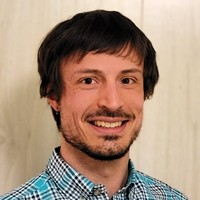

{.headshot fig-alt="Colin Bundschu"}

I am a BIDMaP Postdoctoral Fellow in Kristin Persson's group at UC Berkeley, where I do atomistic calculations of the thermodynamics of disorder in metal oxides. Before that I did my PhD in applied physics at Cornell, co-advised by Héctor Abruña and Peter Frazier, doing theoretical electrochemistry on metal oxides, and before that I was a software engineer at Microsoft Game Studios, Rockstar Games, and Oculus VR.

I was the computational lead on seven experimental collaborations (JACS ×2, Nature Catalysis, PNAS, ACS Catalysis ×2, Chemical Reviews), and I wrote and won two 200,000-GPU-hour NSF ACCESS Maximize allocations and a Schmidt AI for Actionable Matter Modeling grant.

**Links:** [CV](CV.pdf) · [cbu@berkeley.edu](mailto:cbu@berkeley.edu) · [GitHub](https://github.com/ColinBundschu) · [Google Scholar](https://scholar.google.com/citations?user=zsGf6JQAAAAJ) · [LinkedIn](https://www.linkedin.com/in/ColinBundschu)
