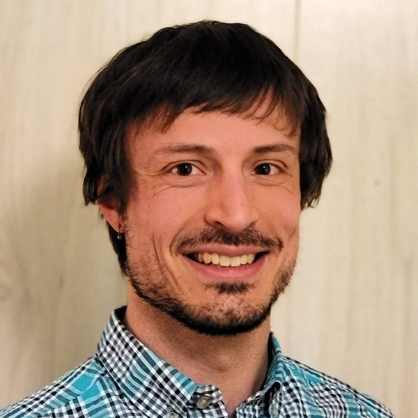

{.headshot fig-alt="Colin Bundschu"}

I am a BIDMaP Postdoctoral Fellow in Kristin Persson's group at UC Berkeley, where I do atomistic calculations of the thermodynamics of disorder in metal oxides. Before that I did my PhD in applied physics at Cornell, co-advised by Héctor Abruña and Peter Frazier, doing theoretical electrochemistry on metal oxides, and before that I was a software engineer at Microsoft Game Studios, Rockstar Games, and Oculus VR.

My research builds computational tools that converge, in both the mathematical and the numerical sense, so that a chemist can ask for a quantity to a stated tolerance and get it. The program has three parts, described on the [Research](research.qmd) page:

- **Exact methods for materials.** A library, *symat*, that represents crystals and molecules as labeled point sets over exact rational arrays, so that symmetry, Voronoi partitions, and coordination are computed exactly and once. Built on it: a from-scratch MACE in numba with analytic Hessians, a geometry relaxer with a symmetry certificate, a bond-valence solver, and a cluster expansion with Wang–Landau sampling.
- **Electronic structure with a limit.** An all-electron, grid-free, parameter-free hierarchy for solids: periodic Hartree–Fock in a generated Gaussian basis, correlated with gap-selected spin-flip EOM-LCCSD, with six explicit convergence knobs and no other setting. Silicon runs on a laptop.
- **Thermodynamics learned from measurement.** Inverting measured disorder thermodynamics to effective cluster interactions with Bayesian inference and conformal-calibrated uncertainty, and choosing the next experiment to shrink that uncertainty.

I was the computational lead on seven experimental collaborations (JACS ×2, Nature Catalysis, PNAS, ACS Catalysis ×2, Chemical Reviews), and I wrote and won two 200,000-GPU-hour NSF ACCESS Maximize allocations and a Schmidt AI for Actionable Matter Modeling grant.

**Links:** [CV](CV.pdf) · [cbu@berkeley.edu](mailto:cbu@berkeley.edu) · [GitHub](https://github.com/ColinBundschu) · [Google Scholar](https://scholar.google.com/citations?user=zsGf6JQAAAAJ) · [LinkedIn](https://www.linkedin.com/in/ColinBundschu)
